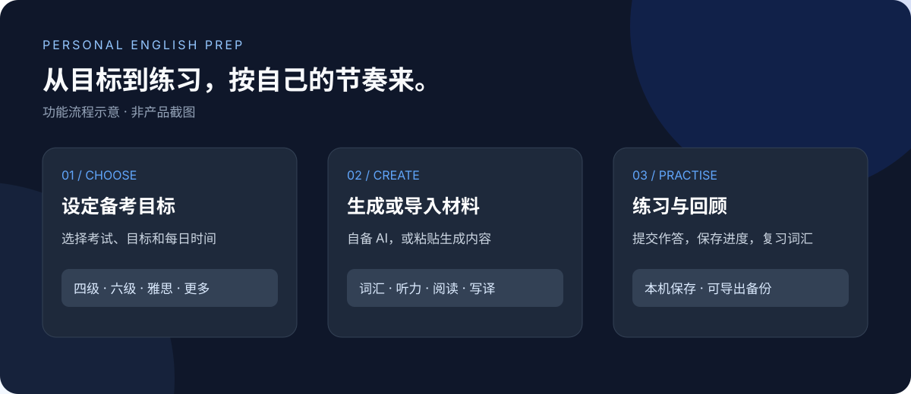

# 个人英语备考工具

选择你的考试目标，将自己准备的学习材料放在一起练习。词汇、听力、阅读、写作和翻译集中在一个页面；需要时，可以用自己的 AI 服务生成材料或获取反馈。



> 项目目前处于早期开发阶段。它可以用于体验和本机练习，但尚不能完整替代成熟的备考平台：内置同步需要自托管和配置 HTTPS，尚未完成真实设备验证；也未内置官方真题或原版音频。功能图是示意图，不是页面截图。

## 功能一览

| 你想做什么 | 当前支持 |
| --- | --- |
| 设置学习方向 | 选择四级、六级、雅思、托福、多邻国或其他考试；填写目标和每天可用时间 |
| 准备学习内容 | 复制生成要求到任意 AI 工具并导入 JSON；也可使用自己的兼容 AI 服务和密钥直接生成 |
| 安排每天的学习 | 按导入材料与学习时间分配词汇、听力、阅读和表达练习；可手动标记完成，未完成不累加 |
| 记单词 | 查看释义和例句，以「知道、模糊、不知道、已熟练掌握」记录掌握情况，并可练习拼写；到期词汇可在本机复习 |
| 听力练习 | 选择本机音频；导入有时间标记的题目，播放对应片段，查看答案和讲解；支持 0.5 倍速、英文或中英逐句字幕 |
| 阅读与表达 | 阅读导入的材料并完成选择题或文字回答；写作前可选 AI 思路指导，写作和翻译草稿自动保存在浏览器 |
| 获得 AI 反馈 | 可用自己的兼容 AI 服务和密钥请求反馈；能匹配到原文时，会在作答副本上标出问题片段 |
| 针对性强化 | 根据当天已记录的错题生成原创练习，需要自己的 AI 密钥 |
| 离线查词 | 输入单词或双击英文查询，支持连字符和部分词形还原；释义不按考试频率排序，可能包含繁体 |
| 保存学习数据 | 导出本机备份；可选部署单工作区同步服务，在设备输入同一密钥同步 |

复习功能以词汇为主。AI 内容和反馈可能出错，请自行核对；项目不提供官方评分，也不保证考试成绩。

## 快速开始

### 1. 运行项目

需要 Python 3 和现代浏览器。在项目目录打开终端：

```bash
python -m http.server 5174 --bind 127.0.0.1
```

打开 `http://127.0.0.1:5174/`。按 `Ctrl+C` 停止服务。请通过本地服务器打开，不要直接双击 HTML 文件：浏览器可能限制模块加载。

### 2. 创建一组练习

1. 选择考试，填写目标及学习时间。
2. 点击「体验示例」，再点击「导入并查看」，可先试用页面。
3. 要使用自己的内容，点击「复制 AI 生成要求」，粘贴给你选择的 AI 工具，再将它返回的 JSON 粘贴到导入框。
4. 查看导入内容，开始词汇、听读或写译练习。

也可以填写 OpenRouter 或其他兼容 Chat Completions 的 HTTPS 服务地址、对应密钥及模型 ID，直接生成内容。仅使用信任的地址：密钥和请求内容会直接发送给该地址。密钥为可选项，手动导入不需要密钥。

### 3. 听力与复习

听力练习中选择有权使用的本机音频文件。若导入材料的题目带有正确的开始、结束时间，可点击「播放本题」。如需使用逐句字幕和「回到上一句」，请在 `lines` 中提供字幕及对应起始时间。浏览器刷新后需重新选择本机音频。

在词汇区先回忆意思并选择「知道」「模糊」「不知道」或「我已熟练掌握」，查看释义后仍可改选；也可以练习拼写。每天最多安排 20 个新词；当日未开始的新词会在次日优先安排，已掌握的词不进入到期复习。通过「到期复习」查看本考试中已收录材料的到期词；早期版本未保留词条内容时，需重新导入材料。该调度是简单的间隔复习，尚非完整的个性化备考算法。

## 自备材料格式

导入内容是 JSON 对象，以下为原创格式示例。`questions` 中的 `answer` 从 **0** 开始计数；`start` 和 `end` 以秒为单位。题目时间应与自行选择的音频对应。也可用 `"segments": [[材料开始秒, 材料结束秒], [问题开始秒, 问题结束秒]]` 顺序播放不连续片段；填写 `segments` 时优先使用它。AI 未听到录音，不能可靠生成时间点，请按实际录音核对。

```json
{
  "title": "今日学习",
  "plan": ["复习词汇", "阅读练习"],
  "vocabulary": [
    {"word": "assess", "meaning": "评估", "example": "We assess results.", "translation": "我们评估结果。"}
  ],
  "listening": {
    "transcript": "A student studies every day.",
    "question": "What does the student do?",
    "lines": [{"english": "A student studies every day.", "chinese": "一名学生每天学习。", "start": 0}],
    "questions": [{"question": "What does the student do?", "options": ["Study daily", "Travel"], "answer": 0, "explanation": "原文说这位学生每天学习。", "start": 0, "end": 4}]
  },
  "reading": {
    "passage": "Practice helps learners improve.",
    "question": "What helps learners improve?",
    "questions": [{"question": "What helps learners?", "options": ["Practice", "Waiting"], "answer": 0, "explanation": "原文提到练习有帮助。"}]
  },
  "writing": "Describe a useful learning habit.",
  "translation": "坚持学习需要耐心。"
}
```

请使用原创、已获授权或其他有权使用的材料。仓库不附带考试真题或录音；导入材料的权利和准确性由使用者负责。

## 导入已有的个人站听力资料

如果你已有自己有权使用的旧版资料文件，可在本机将其转换为练习格式，不需要把题目或音频上传到本仓库：

```bash
node tools/import-original.mjs "旧版 dist 目录" "本机输出目录"
```

脚本只解析其中的 JSON 数据，不执行文件里的代码；每个听力题组生成一个 JSON。在“导入本机练习文件”中可一次选择多个 JSON，之后通过“已导入的练习”切换；也可将 JSON 粘贴到导入框。在听力区选择与这套题相匹配的本机录音。「播放本题」会依次播放该题组材料和本题问题。每次导入一组；音频需自行提供，转换文件不会包含录音。请自行确认对资料的使用权，不要公开分享未获授权的内容。

## 单词发音

词卡可直接选择英式或美式发音。默认使用设备上可用的英语语音；音色取决于设备，不保证真人录音效果。也可用自己的词表通过可选脚本生成本地合成语音：

```bash
python tools/generate_word_audio.py 我的词表.json
```

脚本需要安装 Kokoro、NumPy、soundfile 及其运行依赖，首次运行会下载模型；生成前请核查模型、声音与素材的许可。把输出的 `voices` 目录放在网站目录中即可优先播放生成的音频。此环境尚未实际生成或试听这些音频，生成文件不会自动加入备份或离线缓存。

## 安装到主屏幕与离线使用

iPhone / iPad 可尝试在 Safari 打开 HTTPS 网站，点“分享”后选择“添加到主屏幕”；其他设备请使用浏览器的安装入口。首次联网加载完成后，网站尝试缓存页面、脚本和本地词典；个人选择的音频、AI 请求和设备同步不包含在离线缓存中。iPhone 与 iPad 的安装和离线行为尚需实机验证。

## AI、备份与隐私

- **AI 服务密钥**仅留在当前页面输入框，不写入项目文件或本地存储；刷新后需重新输入。建议在可信设备上使用，并在服务商处设置额度上限。
- 若启用自托管同步，**同步密钥**会单独保存在该设备的浏览器存储中，关闭同步时移除；它不会包含在学习备份中。取得同步密钥的人可能访问该工作区，请勿公开分享。
- 点击生成或反馈时，相关目标、题目或作答会发送到你填写的服务地址及其上游模型供应商，可能产生费用。
- 导入材料和练习记录保存在当前浏览器。清除浏览器数据会删除未备份的内容；音频文件不会包含在备份中。
- 「学习数据」区域可导出备份或从备份恢复。恢复会覆盖备份中包含的本机对应记录。可选的同步服务需自行部署；若未配置，可用备份迁移。

## 可选：自托管同步

同步服务只适合单工作区、单进程部署，不是多用户共享服务。需要 Node.js、可用的 HTTPS 域名以及反向代理。先生成至少 32 字节的随机密钥，并设置环境变量 `SYNC_TOKEN`、`SYNC_FILE` 和 `SYNC_PUBLIC_ORIGIN`（网站的 HTTPS 源，不带路径）；运行 `node sync/start.mjs`。例如在受信任的机器上，可运行 `node -e "console.log(require('node:crypto').randomBytes(32).toString('base64url'))"` 生成同步密钥。不要把生成结果放入仓库、公开日志或截图。代理应把同源 `/api/sync` 转发到本机 `127.0.0.1:8787`，静态页面使用同一 HTTPS 域名。`SYNC_FILE` 必须是应用目录及其他所有公开静态目录之外的绝对路径；请设置仅服务账户可读写的权限并定期备份。路径检查不识别符号链接，还需核验静态服务器和代理配置，确保状态文件不会被公开访问。

在网页「学习数据 → 设备同步」中输入该密钥；各设备需输入相同密钥。密钥保存在浏览器中，不包含在备份里。客户端定期同步；若同一内容发生冲突，页面显示双方值供选择。公开托管或多实例部署前还需要安全、恢复和实际多设备测试。

## 常见问题

**不填密钥可以用吗？** 可以。使用示例或手动导入材料均无需密钥；AI 生成和反馈需要可用的服务及密钥。

**为什么没有声音？** 请先选择本机音频文件，并检查浏览器是否支持文件格式。题目片段的起止秒数也需要与音频匹配。

**AI 请求返回 403 或无法连接？** 请核对服务商的地区、模型权限和浏览器跨域支持；使用该地区合法可用的服务地址和对应密钥。不能仅凭状态码断定余额不足。

**为什么没有反馈或讲解？** 题目讲解需要在导入数据中提供；AI 反馈则需要填写可用的 AI 服务地址、对应密钥与模型。模型服务可能收费或返回错误。

**进度能自动同步到手机吗？** 可自行部署单工作区同步服务，并在两台设备配置相同密钥。默认静态站没有同步服务；也可用备份迁移。真实手机和 iPad 的跨设备流程尚未验证；本地 HTTP 双客户端测试覆盖了认证、冲突和重启恢复，但不等于生产部署验证。

## 开发与验证

无需构建步骤；运行本地 HTTP 服务即可。Node.js 可用于运行基础测试：

```bash
node exam-profiles-test.mjs
node training-test.mjs
node ai-client-test.mjs
node pronunciation-test.mjs
node pwa-test.mjs
node material-library-test.mjs
node dictionary-test.mjs
node targeted-training-test.mjs
node daily-plan-test.mjs
node import-original-test.mjs
node exercise-test.mjs
node practice-integration-test.mjs
node --test sync/*-test.mjs
```

这些测试覆盖考试选项、导入校验、部分词汇调度和模拟 AI 请求；它们不代表真实模型、所有手机或音频格式均已验证。

主要文件：`exam-setup.html` 为页面入口，`exam-profiles.js` 处理考试选项和材料格式，`training.js` / `exercise.js` 负责练习界面，`ai-client.js` 负责可选的 AI 请求。

## 许可

代码采用 [MIT 许可证](LICENSE)。离线词典改用 KOReader 英汉词典的派生数据，词典数据采用 CC BY-SA 4.0，见 [词典许可](dictionary/LICENSE.txt)与[来源及署名](dictionary/ATTRIBUTION.txt)。其中部分上游数据来源的再分发权利尚需逐项核实；公开分发前不要把保留许可证理解为已完成全部来源的授权审计。本项目与考试机构无官方关联；各考试名称和商标归其权利人所有。
