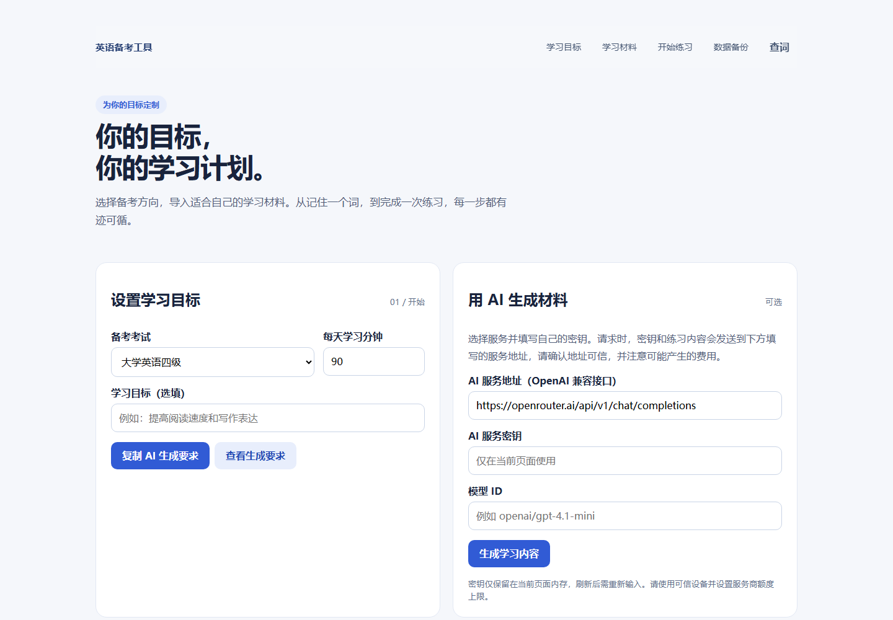
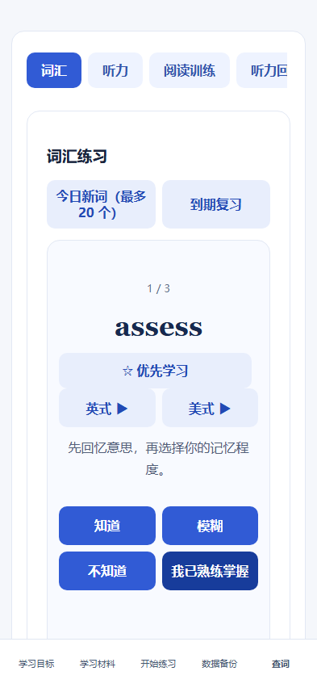
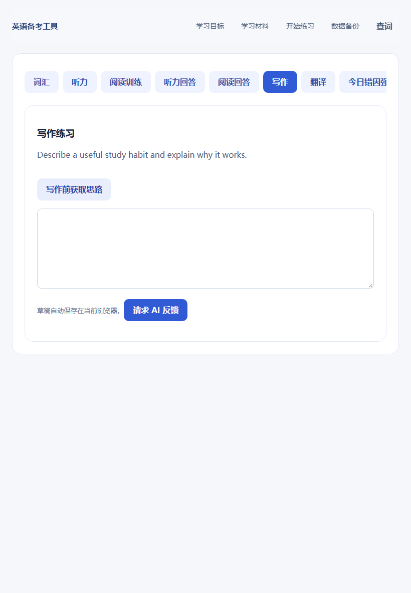

# 个人英语备考工具

[](LICENSE)
[](.github/workflows/ci.yml)
[](manifest.webmanifest)

一个只为学习者服务、无需账号的英语训练 PWA。选择四级、六级、雅思、托福、多邻国或自定义目标，导入自己有权使用的材料，再在同一处完成词汇、听力、阅读、写作、翻译、AI 反馈和今日错因强化。

它不附带官方真题、原版录音或付费内容；材料由使用者自行导入或通过自己的 AI 服务生成。



## 界面预览

| 手机词汇训练 | 手机逐题听力 | iPad 写作与反馈 |
| --- | --- | --- |
|  |  |  |

页面采用简约蓝色界面：手机使用固定底部导航，训练模块用横向标签切换；iPad 和桌面使用更宽的双栏布局。所有主要按钮均按触屏尺寸设计，并支持 `prefers-reduced-motion`。

## 能做什么

| 模块 | 能力 |
| --- | --- |
| 学习目标 | 四级、六级、雅思、托福、多邻国和自定义考试；设置每日 5–480 分钟与个人目标 |
| 今日计划 | 按现有材料和时间自动分配词汇、听力、阅读、表达；做不完不累加，第二天重新安排 |
| 词汇 | 每日最多 20 个新词；知道、模糊、不知道、已熟练掌握四档反馈；到期复习、拼写、优先词、英美发音 |
| 听力 | 每题直接显示题目和选项；本机录音、逐题片段、0.5–1.5 倍速、上一句、英文/中英逐句字幕、答案与讲解 |
| 阅读 | 原文、题目、选项、提交后讲解均在页面内完成，无需打开 PDF |
| 写作与翻译 | 草稿自动保存；写前获取思路；AI 在作答副本上标出原句并逐条给出最小修改 |
| 今日错因强化 | 综合当天记录的错误，由可选 AI 生成一组原创针对性练习，不需要逐项配置 |
| 离线词典 | 按首字母分片加载，支持连字符和常见词形还原；双击英文可直接查询 |
| 数据 | 本机备份与恢复；可选的单工作区、无登录、多设备同步 |
| 安装 | PWA 清单、离线应用壳、iPhone/iPad 主屏幕图标及桌面安装入口 |

词汇到期复习只处理词汇，不把听力或阅读错题堆进复习队列；听读错误仅作为当天 AI 强化的上下文。AI 反馈和生成内容可能出错，练习估分不是官方成绩。

## 工作方式


1. 选择考试目标和每天可用时间。
2. 使用内置原创示例、自备 JSON、本机旧资料转换器，或自己的 AI 服务准备内容。
3. 网站为当天显示一组材料；第二天不会自动打开昨天的题，但历史材料仍留在资料库，可主动切换或删除。
4. 词汇掌握度、草稿、答案、完成状态和错因均保存在浏览器。
5. 可导出备份，或部署可选同步服务让手机、iPad 和电脑共享进度。

## 快速开始

需要 Python 3 和现代浏览器：

```bash
python -m http.server 5174 --bind 127.0.0.1
```

打开 `http://127.0.0.1:5174/`，点击「体验示例」再点击「导入并查看」。也可直接打开聚焦演示：

```text
http://127.0.0.1:5174/exam-setup.html?demo=1&panel=vocabulary
http://127.0.0.1:5174/exam-setup.html?demo=1&panel=listening
```

不要直接双击 HTML 文件，浏览器会限制 ES Modules、PWA 和本地资源加载。

## 准备学习材料

### 让任意 AI 工具生成

在页面选择目标，点击「复制 AI 生成要求」，将要求发送给你信任的 AI 工具，再把 JSON 导入页面。此方式不需要在网站填写 API 密钥。

生成要求会根据所选考试调整训练重点。四、六级包含汉译英；雅思、托福和多邻国使用通用听读写训练，不伪装成官方评分系统。

### 在页面调用自己的 AI 服务

填写 OpenAI Chat Completions 兼容的 **HTTPS** 地址、API 密钥和模型 ID。密钥是可选项，只保留在当前页面内存，刷新即清除；它不会进入备份、同步、仓库或 Service Worker 缓存。请求内容会发送给所填服务及其上游模型，可能产生费用。

- 只使用可信地址和可信设备；
- 在服务商设置消费上限；
- 使用支持浏览器 CORS 的端点；
- 不要在截图、Issue、JSON 或 Git 提交中放入密钥。

### 导入本机文件

页面支持一次选择多份 JSON，随后从资料库切换。当天选中的材料以日期隔离；次日进入网站时不会自动沿用昨天的练习。首次从旧版升级时，旧的“当前练习”会一次性迁移到升级当天。删除资料只移除资料库条目，已产生的词汇掌握度和学习记录仍保留。

最小格式：

```json
{
  "title": "今日主题",
  "plan": ["复习词汇", "听力与阅读"],
  "vocabulary": [
    {
      "word": "assess",
      "meaning": "评估；评价",
      "example": "We assess our progress every week.",
      "translation": "我们每周评估自己的进步。"
    }
  ],
  "listening": {
    "audioId": "optional-stable-audio-id",
    "transcript": "A student studies every day.",
    "lines": [
      {"english": "A student studies every day.", "chinese": "一名学生每天学习。", "start": 0}
    ],
    "questions": [
      {
        "question": "What does the student do?",
        "options": ["Study daily", "Travel"],
        "answer": 0,
        "explanation": "原文说明学生每天学习。",
        "start": 0,
        "end": 4
      }
    ]
  },
  "reading": {
    "passage": "Practice helps learners improve.",
    "questions": [
      {
        "question": "What helps learners improve?",
        "options": ["Practice", "Waiting"],
        "answer": 0,
        "explanation": "文章直接提到 practice。"
      }
    ]
  },
  "writing": "Describe a useful learning habit.",
  "translation": "坚持练习需要耐心。"
}
```

`answer` 从 0 开始；`start` / `end` 以秒为单位。AI 未听到真实录音时不能可靠生成时间点，请按录音核对。题目必须至少有两个非空选项和有效答案序号，否则导入时会被过滤，避免产生无法作答的卡片。

### 转换自己的旧资料

如果本机已有自己有权使用的旧版站点资料，可转换为本项目格式：

```bash
node tools/import-original.mjs "旧版 dist 目录" "本机输出目录"
```

脚本只解析已知 JSON 数据，不执行旧文件中的代码；会分别输出听力、阅读和写译练习，不复制录音。请自行确认资料使用权，不要公开提交转换结果。

## 词汇调度算法

调度以「考试 + 单词」为范围，不因切换材料丢失：

- 每个自然日最多引入 20 个新词；前一天尚未开始的词优先；
- `不知道` 约 5 分钟后重现，`模糊` 约 10 分钟后重现；
- `知道` 按 1、2、4、7、15、30、60 天逐步拉长间隔；
- 12 小时内重复点「知道」不会虚增阶段；
- `已熟练掌握` 退出到期队列，可在当前卡片改选以撤销误点；
- 标星词优先进入当天或下一天队列；
- 拼写错误会重新安排并记录为当天错因；
- 每轮中的模糊和遗忘词会在结束前再次出现，直到学习者重新判断。

这是透明、可预测的间隔复习算法，不声称复刻任何商业应用，也不保证考试分数。

## 听力、字幕与本机录音

在听力页选择自己有权使用的音频。选择后文件会尝试写入该设备的 IndexedDB；同一设备刷新后可恢复，也可点「删除本机录音」。浏览器在存储压力、隐私模式或清理站点数据时仍可能移除文件。

音频不进入文本备份或设备同步。每题时间片、上一句、逐句字幕和 0.5 / 0.75 / 1 / 1.25 / 1.5 倍速都依赖材料中的正确时间信息。网站不会上传录音，也不会下载或再分发官方音频。

## 离线词典与发音

离线词典按首字母拆成 27 个分片，第一次查某个首字母时才加载对应数据，随后由 PWA 缓存。支持 `well-being` 等连字符词和部分常见词形。词典内容来自 KOReader Dicts 的英汉数据；许可证和转换说明见 [词典许可](dictionary/LICENSE.txt)与[来源署名](dictionary/ATTRIBUTION.txt)。

词卡提供英式和美式按钮。默认使用设备上的自然英语语音；如果配置了本地录音，则优先读取，并在 1.8 秒内无法播放时自动回退。可用 [Kokoro 官方推理库](https://github.com/NVIDIA/kokoro)批量生成本地合成发音：

```bash
python -m pip install -r tools/requirements-tts.txt
python tools/generate_word_audio.py 我的词表.json --output voices
```

输入可以是包含 `vocabulary` 的学习材料，也可以是单词数组：

```json
["assess", "well-being", "consistent"]
```

默认美式声音为 `af_heart`、英式声音为 `bf_emma`，可用 `--us-voice`、`--uk-voice`、`--speed 0.95` 与 `--overwrite` 调整。生成的 `voices/manifest.json` 和 WAV 会被发布暂存脚本安全地一并复制，并在首次播放后按需离线缓存。模型、声音和生成音频不随本仓库分发；使用或再分发前请核查其当前许可证。

## 安装到主屏幕

- iPhone / iPad：Safari → 分享 → 添加到主屏幕；
- Android / 桌面 Chromium：使用地址栏或浏览器菜单中的安装入口。

已用 Chromium 在 393 × 852、820 × 1180 和 1440 × 1000 视口完成页面检查；iOS Safari 的音频格式、存储配额和 PWA 生命周期仍由具体系统版本决定，长期使用前建议在自己的设备做一次安装、离线与录音恢复检查。

## 备份、同步与冲突

静态版可直接导出 JSON 备份。备份包含材料、进度、答案和草稿，不包含 AI 密钥、同步密钥或本机录音。

可选同步服务是 **无账号、单工作区、单进程** 设计。所有设备输入同一随机密钥即可合并：

- 材料数组按稳定 `id` 合并，不会因另一台设备新增材料而整表覆盖；
- 已完成状态按字段合并；同一单词同时更新时优先保留「已熟练掌握」，否则保留时间更近的记忆判断；
- 真正竞争的标量编辑才显示冲突，并让用户选择本机或云端值；
- 断线后保留本机内容，下一次同步重试；
- 服务端限制请求大小并使用原子文件替换；测试覆盖重启恢复、认证、并发和真实 HTTP/临时 HTTPS。

生成至少 32 字节随机密钥：

```bash
node -e "console.log(require('node:crypto').randomBytes(32).toString('base64url'))"
```

设置 `SYNC_TOKEN`、`SYNC_FILE`（静态目录之外的绝对路径）和 `SYNC_PUBLIC_ORIGIN`（网站 HTTPS 源），然后运行：

```bash
node sync/start.mjs
```

反向代理应让网站与 `/api/sync` 使用同一 HTTPS 源。参考 [Caddy 配置](sync/Caddyfile.example)。同步密钥保存在启用同步的浏览器本地存储中；任何取得它的人都能访问该工作区。

## 部署

### 仅静态功能

不要直接发布整个仓库。先把白名单内的公开文件复制到一个新的空目录：

```bash
node sync/stage-public.mjs /absolute/path/to/empty-public-directory
```

脚本拒绝相对路径、仓库内部目录、非空目录、符号链接文件和不安全的声音清单。然后把输出目录交给任意 HTTPS 静态服务器。静态部署支持全部本机功能和可选 AI；不提供跨设备同步。

### 静态页面 + 同步

1. 运行 `stage-public.mjs` 生成公开目录；
2. 将 `SYNC_FILE` 放在该目录及其他静态根目录之外；
3. 仅让同步后端监听 `127.0.0.1:8787`；
4. 使用 Caddy/Nginx 为静态文件和 `/api/sync` 提供同源 HTTPS；
5. 设置服务账户文件权限、备份状态文件，并在实际手机和电脑上验证一次同步。

## 开发与验证

```bash
node tools/run-tests.mjs
git diff --check
```

自动化测试覆盖考试目标、导入校验、每日计划、词汇调度、逐题听力、字幕、IndexedDB 音频、离线词典、PWA、模拟 AI、备份、真实 HTTP/临时 HTTPS 同步、认证、并发合并、冲突、重启恢复、公开文件暂存和 Python 工具语法。GitHub Actions 会在 push 和 Pull Request 上运行同一套检查。

自动化测试不等于真实 AI 供应商、每种音频编码或所有 Safari 版本都已验证。

## 项目结构

```text
exam-setup.html           单页应用与响应式样式
exam-profiles.js          考试目标、AI 生成要求与导入校验
training.js               词汇、听读写译训练与反馈界面
exercise.js               逐题作答、字幕和音频片段控制
dictionary/               分片离线词典、许可与署名
listening-audio.js        IndexedDB 本机录音
targeted-training.js      今日错因强化
sync/                     无账号单工作区同步与发布白名单
tools/                    测试、旧资料转换与可选 TTS
```

## 隐私、安全与内容边界

- 学习材料默认只保存在浏览器；清除站点数据会删除未备份内容。
- AI 内容只在用户主动请求时发送到自己填写的服务地址。
- 仓库不收集账号、遥测或学习数据。
- 不要导入或公开分享无权使用的真题、原版录音和付费课程。
- 项目与 CET、IELTS、TOEFL、Duolingo 及相关考试机构没有官方关系；名称和商标归其权利人所有。
- 安全报告和密钥泄露处理见 [SECURITY.md](SECURITY.md)，贡献规范见 [CONTRIBUTING.md](CONTRIBUTING.md)。

## 许可证

| 内容 | 许可证/来源 |
| --- | --- |
| 应用代码与原创示例 | [MIT](LICENSE) |
| 英汉词典派生数据 | [KOReader Dicts `en-zh`](https://danielgregorini.github.io/koreader-dicts/en/en-zh/)；按 [CC BY-SA 4.0 与其上游条款](dictionary/LICENSE.txt)分发 |
| 词典署名和转换说明 | [dictionary/ATTRIBUTION.txt](dictionary/ATTRIBUTION.txt) |
| 可选 Kokoro 模型、声音与生成音频 | 不随仓库分发；由使用者按其当前许可证自行取得和使用 |

代码许可证不覆盖使用者导入的题目、音频、模型或 AI 输出。
